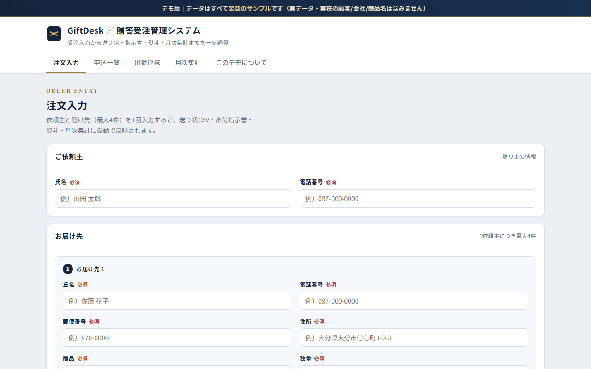
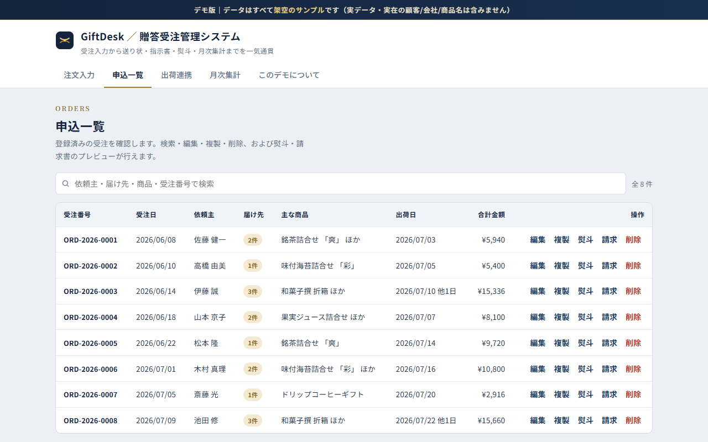
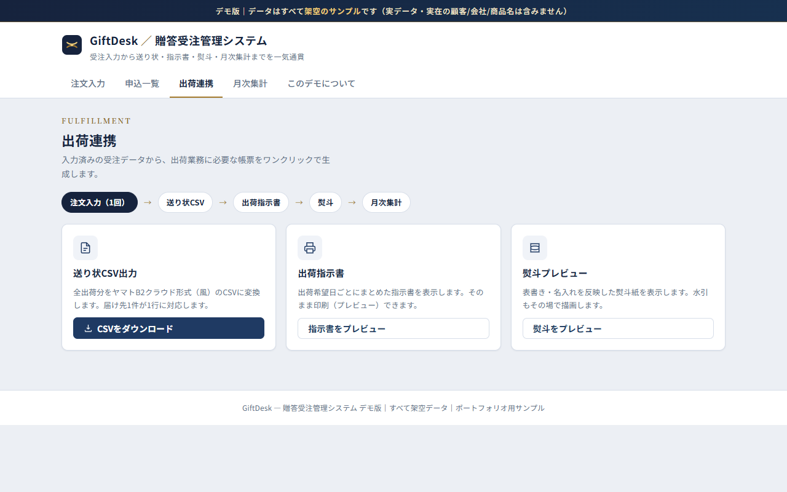
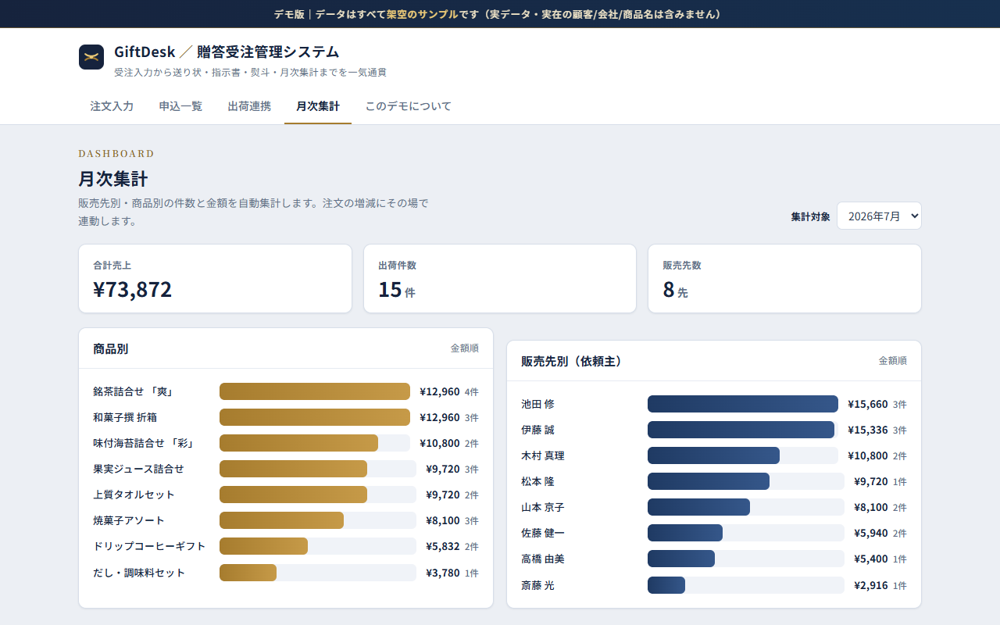

# GiftDesk — 贈答受注管理システム（ポートフォリオ・デモ版）

[](https://takutoshuto-hash.github.io/gift-order-demo/)

[](LICENSE)

実務で開発・運用している社内向け「ギフト受注管理システム」を、**公開用にダミーデータで再現したフロントエンド・デモ**です。
受注を1回入力するだけで、**送り状CSV・出荷指示書・熨斗・月次集計**へ自動連携される—という中核の価値を、バックエンド無しでブラウザ内に再現しています。

> ⚠️ **これはデモです。** 表示される顧客名・会社名・商品名・住所・電話番号・金額はすべて架空のサンプルです。実システムのソースコード・実データ・APIキーは一切含みません。

---

## ライブデモ

**[https://takutoshuto-hash.github.io/gift-order-demo/](https://takutoshuto-hash.github.io/gift-order-demo/)**

| 注文入力 | 申込一覧 |
|---|---|
|  |  |
| **出荷連携（送り状CSV・指示書）** | **月次集計** |
|  |  |

---

## 実装した機能

| 機能 | 概要 |
|------|------|
| 注文入力 | 依頼主＋お届け先（最大4件）を入力。届け先ごとに商品・数量・熨斗・出荷希望日を指定。必須・電話/郵便番号の形式チェックと分かりやすいエラー表示。 |
| 申込一覧 | 登録済み受注のテーブル表示。検索・絞り込み、編集、複製、削除。初期状態で8件のサンプル受注を投入済み。 |
| 送り状CSV出力 | ヤマトB2クラウド形式（風）のCSVを生成し、ブラウザからダウンロード（Blob／Excel向けBOM付きUTF-8）。届け先1件が1行に対応。 |
| 出荷指示書 | 出荷希望日ごとに整形した指示書を表示し、`window.print()` で印刷に対応。 |
| 熨斗プレビュー | 表書き・名入れを反映した熨斗紙を表示。水引はSVGで描画。 |
| 月次集計 | 販売先別・商品別の件数と金額、合計売上を自動集計。CSSの横棒グラフで可視化し、注文の増減に連動。 |
| 請求書（任意機能） | 受注を選択し、明細をまとめて表示・印刷。 |
| リピート注文（任意機能） | 過去注文を複製して入力フォームに反映。 |

---

## 使用技術（このデモ）

- **HTML / CSS / バニラ JavaScript**（単一 `index.html`、ビルド不要）
- フレームワーク・外部JSライブラリ・外部API呼び出しは**不使用**（Webフォント Noto Sans/Serif JP の読み込みのみ）
- 状態はすべてメモリ上（JS変数）で管理。`localStorage` 等は使用せず、リロードで初期化されます。

## 実システムの構成（参考・このデモには含まれない）

デモではなく、実際に運用しているシステムは以下で構築しています。要件定義・設計・実装・運用保守までを一人で担当しました（ソロ開発）。

```
FAX / ハガキ（手書き注文書）        Web申込フォーム
        │ スキャン画像                    │
        ▼                                 ▼
  Gemini API（マルチモーダル）      Google Apps Script（HtmlService SPA）
  氏名・住所・商品・数量を            受注入力・一覧・編集 / 独自セッション認証＋ロール分離
  JSONで構造化抽出                          │
        │                                  │
        └──────────────▶ Google スプレッドシート（バックエンドDB）◀───┘
                                  │
          ┌───────────────┬───────┴────────┬─────────────────┐
          ▼               ▼                ▼                 ▼
    送り状CSV        出荷指示書・熨斗     請求書・月次集計    BigQuery → Looker Studio
   （ヤマトB2）     （ミリ単位の印刷）                      （売上・出荷状況の可視化）
```

- 繁忙期は **月1,000〜2,000件** を3部門で処理。手書き時代の転記ミスを撲滅し、月次集計・請求を自動化
- **Claude API** は入力補助・データ整形（表記ゆれの正規化など）に利用
- 現在は、チャネルごとに分かれていた受注・出荷システムを「1つの注文モデル」に統合し、PHP + MySQL の自社アプリへ本番移行済み（設計記録: [Zenn](https://zenn.dev/takutoshuto/articles/e12ef58cfe8f18)）

### 運用コストと技術選定の判断

- OCR以外はすべて **Google 無料枠内で運用し、月額 ¥0**。
- 帳票OCR（**Gemini API**）のみ、**有料（従量課金）で運用**しています。無料枠ではリクエスト内容がモデル学習に利用されうるため、顧客の氏名・住所などを含む FAX を扱う本システムでは、**コスト削減よりも顧客データの保護を優先し、あえて有料枠を選択**しました。処理量が小さいため月額はごくわずかです。
- OCR は当初 **Google Cloud Vision API** を使用していましたが、手書き・崩れた FAX の構造化抽出精度と、後処理ルールの削減を目的に **Gemini API へ移行**しました（経緯: [Zenn](https://zenn.dev/takutoshuto/articles/a9e73fa4ed60ca)）。

---

## ローカルでの開き方

ビルドやサーバーは不要です。

```bash
git clone https://github.com/takutoshuto-hash/gift-order-demo.git
cd gift-order-demo
```

`index.html` をブラウザでそのまま開くだけで動作します（ダブルクリック、またはブラウザにドラッグ＆ドロップ）。GitHub Pages は `main` ブランチのルートをそのまま公開しています。

---

## 設計上の要点

- **1受注 = 依頼主 ＋ 届け先（最大4）** の構造。届け先1件が「1出荷」に相当し、CSVの1行・指示書の1明細・月次集計の1レコードとして一貫して扱われます。「入力は1回、出力は自動連携」という実務価値を素直に表現するためのモデルです。
- 画面遷移は SPA 風のタブ切替（`go()`）。イベントは `data-action` 属性による委譲で一元管理。
- アクセシビリティ：キーボード操作可、フォーカスリング可視、`prefers-reduced-motion` を尊重、レスポンシブ（スマホ〜デスクトップ）。

---

## 関連

- 実システムの作り方と設計判断: [FAXの手書き注文を、GASとスプレッドシートだけで「送り状CSV〜請求書まで一気通貫」にした話](https://zenn.dev/takutoshuto/articles/bc2ff859475742)
- 同じ作者のAIエージェント（Python / AWS SAM）: [social-post-agent](https://github.com/takutoshuto-hash/social-post-agent) ・ [mail-triage-agent](https://github.com/takutoshuto-hash/mail-triage-agent)

## ライセンス / 注意

- [MIT License](LICENSE)。本デモは学習・ポートフォリオ目的のサンプルで、**架空データのみ**を含みます。
- 実業務データ・実在の顧客/会社/商品名・認証情報は含まれていません。

## 制作者

- 氏名：**首藤卓登（Takuto Shuto）**
- GitHub：https://github.com/takutoshuto-hash ・ Zenn：https://zenn.dev/takutoshuto
